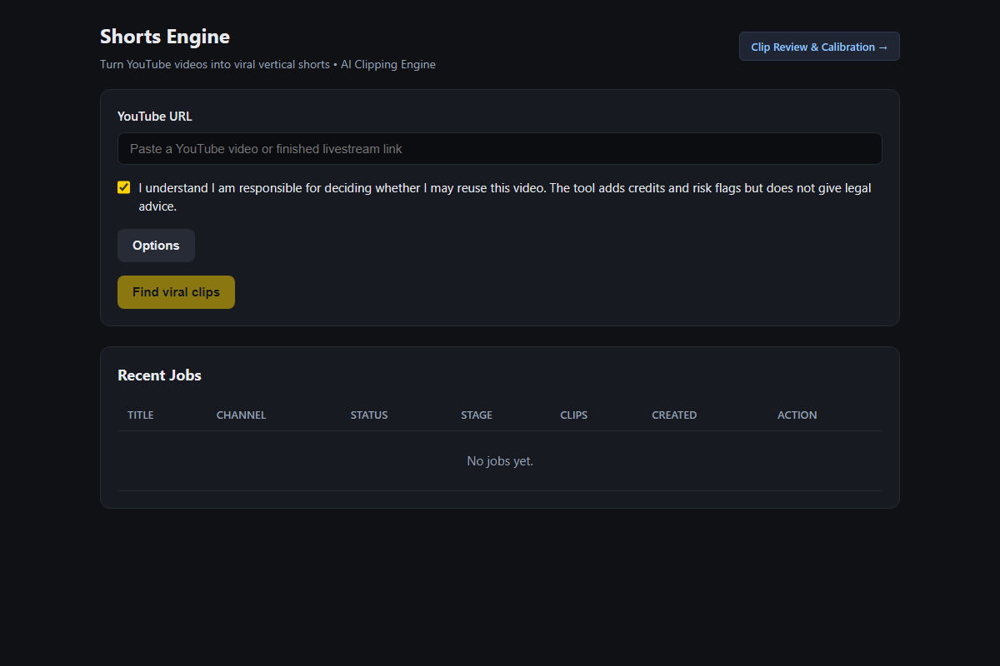
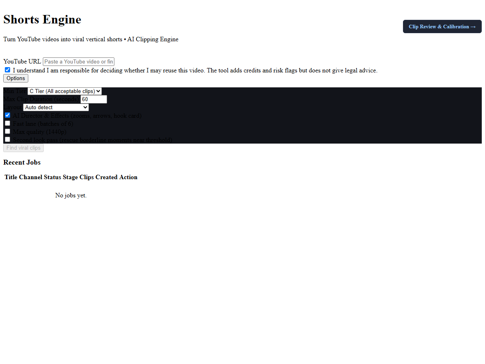
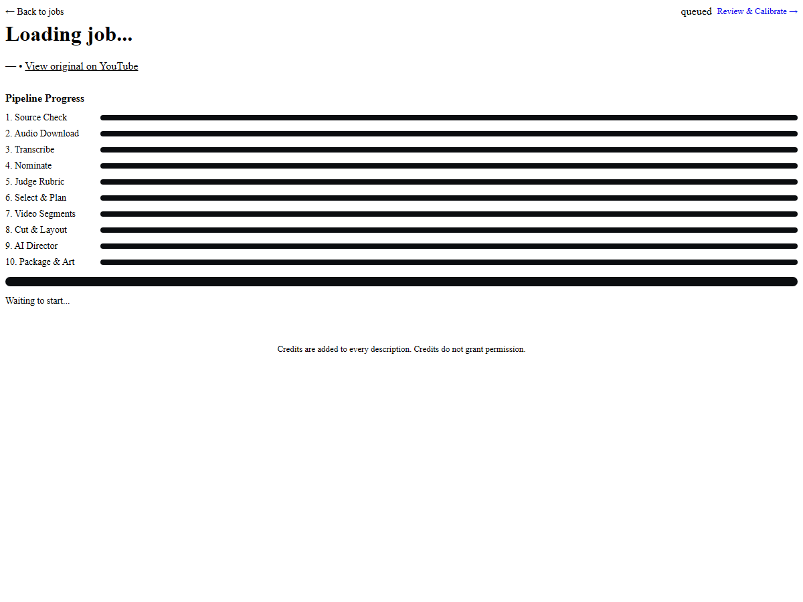
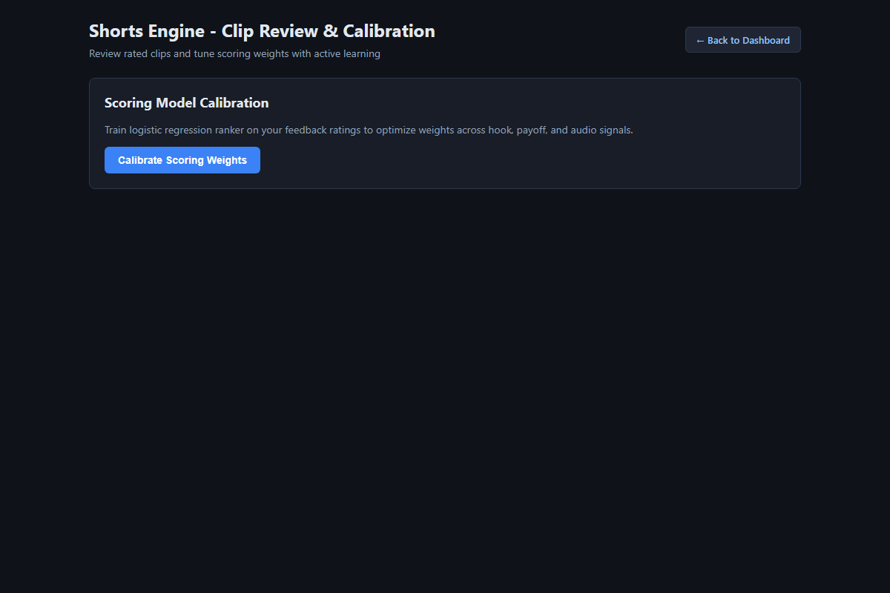
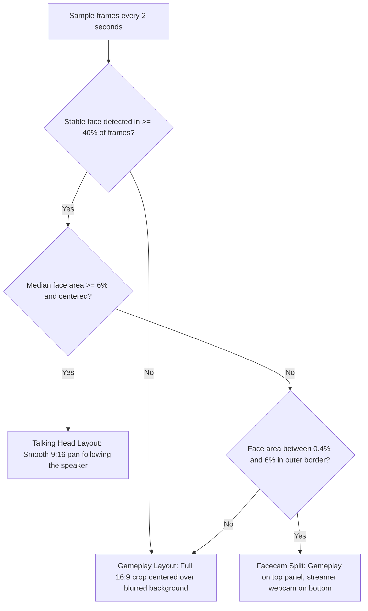

# Shorts Engine

[](https://www.python.org/downloads/)
[](https://microsoft.com/windows)
[](https://developer.nvidia.com/cuda-toolkit)
[](https://fastapi.tiangolo.com)
[](https://ollama.com)
[](https://ffmpeg.org)
[](docs/MODELS.md)

Shorts Engine is a local Windows web application (FastAPI and vanilla HTML/CSS/JavaScript running on `127.0.0.1:8000`) that converts long YouTube videos or local video files into upload-ready 9:16 vertical shorts. It includes automated candidate nomination, sentence-boundary protection, face-aware vertical reframing, animated captions, director effects, and thumbnail generation.

Every machine learning model in the pipeline runs offline on your local GPU and CPU via faster-whisper, ONNX Runtime, and Ollama. The pipeline requires no cloud API keys, paid subscriptions, or external network calls during processing. You review the output clips in the local interface and upload them to your target platforms manually. The application never communicates with external publishing endpoints.

---

## Software Interface

The application runs locally in your browser. Here is the workflow from clip nomination to final review:

### 1. Job Creation and Pipeline Configuration
Paste a YouTube URL or local file path, accept the source policy, and choose your clipping parameters.

<p align="center">
  
</p>

### 2. Layout, Duration, and Effect Controls
Toggle the options panel to configure clip length limits, crop styles, visual director effects, and processing lanes.

<p align="center">
  
</p>

### 3. Pipeline Progress and Live Quality Slider
Monitor the 10-stage processing pipeline in real time. Once nomination completes, adjust the client-side quality threshold slider to filter clips instantly without triggering additional model calls.

<p align="center">
  
</p>

### 4. Review and Calibration Console
Inspect rendered clips, review score breakdowns, verify transcripts, and log audience reception to calibrate the ranking model.

<p align="center">
  
</p>

---

## Pipeline Architecture

The application runs as a deterministic multi-stage funnel designed to keep peak GPU memory below 7.5 GB on an 8 GB VRAM card:

```mermaid
flowchart TD
    A["Video Source (YouTube URL or Local MP4)"] --> B["1. Audio Extraction (16 kHz Mono WAV)"]
    B --> C["2. Speech Recognition (faster-whisper-large-v3-turbo on CUDA)"]
    C --> D["3. Perception: Sentence Integrity (sat-3l-sm ONNX on CPU)"]
    D --> E["4. Story Partitioning (bge-small-en-v1.5 TextTiling on CPU)"]
    
    subgraph Multi_Signal_Sensors ["Sensors (CPU and OpenCV)"]
        F1["RMS Loudness & Z-Scores"]
        F2["Audio Events (AudioSet Classifier)"]
        F3["Voice Emotion & WPM Cadence"]
        F4["Scene Cuts & Motion Histogram"]
    end
    
    E --> Multi_Signal_Sensors
    Multi_Signal_Sensors --> G["5. Moment Proposer (qwen3.5:9b via Ollama)"]
    G --> H["6. Cross-Family Completeness Committee (qwen3.5:9b & gemma4:e4b)"]
    H --> I["7. Narrative Stitching & Cliffhanger Part Splitter"]
    I --> J["8. Candidate Store (SQLite Database)"]
    
    J --> K["Live Quality Threshold Slider (Client-Side Filter)"]
    K --> L["9. Single-Pass NVENC Video Render (FFmpeg)"]
    
    subgraph Packaging ["Post-Processing"]
        M1["Face-Aware 9:16 Reframing (MediaPipe BlazeFace)"]
        M2["Burned ASS Captions (7 Animated Presets)"]
        M3["Topic Thumbnails & 160px OCR Verification"]
        M4["Creator Credit Block & Source Risk Notes"]
    end
    
    L --> Packaging
    Packaging --> N["Output Directory: output/<slug>/"]
```



---

## Local Multi-Model Stack

To operate safely within an 8 GB VRAM ceiling (tested on an RTX 4060 Laptop GPU), the scheduler loads only one large model into GPU memory at a time. Lighter tasks run on the CPU through ONNX Runtime and MediaPipe.

| Component | Model Name | Quantization | Device | Peak VRAM | Task |
|---|---|---|---|---|---|
| **Transcription** | `faster-whisper-large-v3-turbo` | float16 (CTranslate2) | CUDA | ~3,282 MB | Audio transcription and word-level timestamps |
| **Sentence Boundaries** | `sat-3l-sm` (`segment-any-text`) | ONNX optimized | CPU | 0 MB (CPU) | Grammar boundary classification to prevent mid-sentence cuts |
| **Story Blocks** | `bge-small-en-v1.5` | ONNX | CPU | 0 MB (CPU) | 384d sentence embeddings and TextTiling topic detection |
| **Moment Proposer** | `qwen3.5:9b` | Q4_K_M GGUF | CUDA (Ollama) | ~5,600 MB | Candidate moment nomination from transcript sentences |
| **Completeness Judge** | `gemma4:e4b` | Q4_K_M GGUF | CUDA (Ollama) | ~5,400 MB | Cross-family independent validation of candidate clarity |
| **Face Tracking** | MediaPipe BlazeFace Short Range | float16 TFLite | CPU | 0 MB (CPU) | Subject detection and 9:16 layout centering |
| **Subject Matting** | MediaPipe Selfie Segmenter | float16 TFLite | CPU | 0 MB (CPU) | Foreground cutout extraction for thumbnail art |
| **OCR Verification** | RapidOCR (PP-OCRv4) | ONNX | CPU | 0 MB (CPU) | 160px mobile preview readability testing |
| **Visual Verification** | `qwen2.5vl:3b` | Q4_K_M GGUF | CUDA (Ollama) | ~3,100 MB | Action verification and dead-frame detection |

---

## Core Capabilities

### 1. Zero Mid-Sentence Cuts
Standard Whisper timestamps often split speech at arbitrary pauses or token limits, which can cut clips off mid-phrase. Shorts Engine uses the `sat-3l-sm` ONNX model to evaluate token-level syntactic structure. Sentence boundaries snap to true grammatical endpoints, verified by voice-activity pause detection. Automated checks enforce a 0.0% mid-sentence cut rate across all exported clips.

### 2. Multi-Signal Acoustic and Visual Sensors
Moments are selected using multimodal signals combined with transcript text:
* **Audio Energy Profiling:** Measures RMS loudness bursts, silence-to-explosion suspense transitions, and sustained audio peaks.
* **AudioSet Event Classifier:** Identifies specific sound signatures including gunshots, cheering, explosions, screams, and vehicle sounds.
* **Cadence Analysis:** Tracks words per minute (WPM), exclamation density, and gaming hype terminology.
* **Visual Motion Detection:** Runs 2 fps color histogram differences and frame variance checks to confirm visual movement and filter out loading screens.

### 3. Dual-Model Evaluation Committee
To prevent model bias, candidate clips pass through two distinct model families:
1. `qwen3.5:9b` (Qwen family) nominates candidate segments based on sensor events and sentence IDs.
2. `gemma4:e4b` (Gemma family) evaluates each proposal in an independent context for narrative completeness, hook strength, and standalone clarity.

If the two models disagree on boundaries, the boundary repair routine recalculates the clip range.

### 4. Smart Part-Splitting Policy
Long narratives are kept intact whenever possible:
* Videos under 90 seconds are not split.
* If a segment exceeds 90 seconds and tightening fails, the engine looks for narrative cliffhangers (`tension_peak`, `pending_reveal`, or `question_posed`).
* Each part must meet a minimum length of 25 seconds (maximum 4 parts).
* Non-final parts end with a 1.8-second hold frame and an on-screen callout directing viewers to the next part. Successive parts open with a numbered part badge.

### 5. Automated 9:16 Layout Framing
The engine samples frames every 2 seconds to categorize the source video layout:



### 6. Animated Subtitle Presets
The rendering pipeline burns subtitles directly into the video stream via FFmpeg ASS filters. Seven visual presets are available:
* `modern_box`: Rounded box backing with active word tracking.
* `classic_yellow`: High-contrast yellow text with black outlines.
* `minimal_shadow`: Clean white typography with soft drop shadows.
* `cyan`: Cyan lettering with dark stroke outlines.
* `yellow_box`: Solid yellow tag behind the active word.
* `neon_green`: High-saturation green text tuned for gaming highlights.
* `red_gaming`: Bold red lettering for high-intensity moments.

### 7. Hardware-Accelerated NVENC Rendering
Rendering runs as a single-pass FFmpeg process with `-ss` placed before `-i` for fast keyframe seeking. Background blurring scales 270x480 proxies up to 1080x1920 to minimize GPU load. A standard 60-second vertical short renders in approximately 30 seconds on an RTX 4060 GPU.

### 8. Thumbnail Generation and Mobile Readability Check
The engine creates both horizontal (1280x720) and vertical (1080x1920) cover art:
* Extracts foreground creators using the MediaPipe Selfie Segmenter.
* Applies a creator grade: +14% brightness, +22% vibrance, and unsharp-mask edge sharpening.
* Adds high-contrast Anton and Bebas Neue bold typography.
* Tests the generated thumbnail with RapidOCR at 160px width to ensure the title remains legible on mobile feeds.

---

## System Requirements

| Requirement | Minimum | Recommended |
|---|---|---|
| **Operating System** | Windows 11 (64-bit) | Windows 11 (64-bit, Build 22631+) |
| **GPU** | NVIDIA GPU with 6 GB VRAM | NVIDIA GeForce RTX 4060 (8 GB VRAM) or better |
| **NVIDIA Driver** | 535.xx+ | 551.xx+ (with CUDA 12 support) |
| **System RAM** | 16 GB | 16 GB or 32 GB DDR5 |
| **Python** | 3.12.x | 3.12.10 |
| **Local LLM Engine** | Ollama 0.3.0+ | Ollama 0.5.0+ |
| **Storage** | 30 GB free space | 60 GB+ on SSD for weights and video cache |

---

## Installation

### 1. Install System Dependencies

Open PowerShell as an Administrator and install the required tools using `winget`:

```powershell
# Git, Python 3.12, FFmpeg (Gyan build with NVENC), and Deno
winget install --id Git.Git -e
winget install --id Python.Python.3.12 -e
winget install --id Gyan.FFmpeg -e
winget install --id DenoLand.Deno -e
winget install --id Ollama.Ollama -e
```

> [!NOTE]
> Close and reopen PowerShell after running `winget` so your system `PATH` updates. Verify that `ffmpeg -encoders` shows `h264_nvenc`.

### 2. Clone the Repository and Set Up Python

```powershell
git clone https://github.com/your-username/Umation.git
cd Umation

# Create and activate virtual environment
python -m venv .venv
.\.venv\Scripts\Activate.ps1

# Upgrade pip and install dependencies
python -m pip install --upgrade pip
pip install -r requirements.txt

# Install CUDA libraries for Whisper on Windows
pip install nvidia-cublas-cu12 nvidia-cudnn-cu12
```

### 3. Set Up Model Weights

Set your local weights directory in an `.env` file (copied from `.env.example`):

```powershell
copy .env.example .env
```

Ensure your `.env` contains:

```env
WEIGHTS_DIR=D:\Open_Source_Weights
OLLAMA_MODELS=D:\Open_Source_Weights\ollama
OLLAMA_HOST=127.0.0.1:11434
```

Pull the required language models through Ollama:

```powershell
$env:OLLAMA_MODELS = "D:\Open_Source_Weights\ollama"
ollama serve

# In a separate terminal:
ollama pull qwen3.5:9b
ollama pull gemma4:e4b
ollama pull qwen2.5vl:3b
```

Download the remaining support models (BlazeFace, Selfie Segmenter, and open-license fonts):

```powershell
python scripts/download_models.py
```

### 4. Run Preflight Verification

Verify your environment, GPU libraries, and model connections before launching:

```powershell
python scripts/selftest.py --phase 0
```

---

## How to Run

### Option A: Autopilot Launcher (Recommended)
Double-click `start.bat` or run it from PowerShell:

```powershell
.\start.bat
```

This script verifies your Python environment, starts the background Ollama service if it is not already active, launches the FastAPI server, and opens your default browser to `http://127.0.0.1:8000`.

### Option B: Manual Launch
Start the server directly using Uvicorn:

```powershell
python -m uvicorn app.main:app --host 127.0.0.1 --port 8000 --reload
```

Then navigate to `http://127.0.0.1:8000` in your web browser.

---

## Pipeline Presets

When creating a job, choose between three processing presets depending on your available time and hardware budget:

| Feature | Fast | Balanced (Default) | Best |
|---|---|---|---|
| **Audio Transcription** | faster-whisper float16 | faster-whisper float16 | faster-whisper float16 |
| **Sentence Segmentation** | SaT ONNX | SaT ONNX | SaT ONNX |
| **Acoustic Sensors** | RMS energy only | Energy + AudioSet events | Full acoustic suite + Cadence |
| **Nomination Engine** | Single Proposer (`qwen3.5:9b`) | Single Proposer (`qwen3.5:9b`) | Dual Proposers (`qwen3.5:9b`) |
| **Quality Review** | Single heuristic pass | Critic + Narrative stitcher | Cross-family committee (`qwen` + `gemma`) |
| **Tournament Reranker** | Disabled | 5-candidate tournament | Full head-to-head tournament |
| **Visual Verification** | Disabled | Frame variance checks | `qwen2.5vl:3b` visual inspection |
| **Thumbnails** | Standard layout | Standard layout | Popout subject grade + 160px OCR check |
| **Approx. Processing Time** | ~2 minutes | ~5 minutes | ~8 minutes |

---

## Output Structure

Exported packages are organized under the local `output/` directory:

```
output/
└── <video-slug>-<video_id>/
    └── <clip_id>_<tier>[_part<k>of<n>]/
        ├── clip.mp4              # 1080x1920 vertical video (H.264 / AAC)
        ├── cover_9x16.jpg        # 1080x1920 vertical cover for Shorts / Reels
        ├── thumb_16x9.jpg        # 1280x720 horizontal thumbnail for YouTube
        ├── captions.srt          # Clean subtitle file with word timestamps
        ├── captions.ass          # Styled ASS subtitles used for burned captions
        ├── metadata.txt          # Ready-to-copy title, description, tags, hashtags
        ├── metadata.json         # Structured metadata with sensor and layer scores
        ├── credit.txt            # Source attribution block for video descriptions
        ├── edit_list.json        # Visual director event and effect timeline
        └── notes.txt             # Production notes and quality tier breakdown
```

### Sample Output Metadata (`metadata.txt`)

```text
TITLE:
The Impossible Bank Vault Escape | GTA 6

DESCRIPTION:
Trevor finds a back passage into the primary bank vault during the final getaway sequence.

═══════════════════════════════════════════════
ORIGINAL CREATOR ATTRIBUTION:
Source Video: GTA 6 Gameplay Walkthrough Part 12
Creator Channel: ExampleGaming (https://youtube.com/@examplegaming)
Original Broadcast: https://www.youtube.com/watch?v=sample123

All rights remain with the original content creator.
═══════════════════════════════════════════════

HASHTAGS:
#GTA6 #Gaming #Shorts #Walkthrough #Heist #GamingClips
```

---

## Verification and Quality Gates

The repository includes a phase-by-phase self-test suite to verify the pipeline:

```powershell
# Run individual verification phases
python scripts/selftest.py --phase 0   # Environment, GPU libraries, and Ollama connection
python scripts/selftest.py --phase 1   # Network guard, offline isolation, and NVENC render
python scripts/selftest.py --phase 2   # Candidates store, slider responsiveness, and caption presets
python scripts/selftest.py --phase 3   # Audience signals, acoustic sensors, and dynamic fusion
python scripts/selftest.py --phase 4   # Multi-model committee agreement and reranker logic
python scripts/selftest.py --phase 5   # Visual evidence, thumbnail generation, and metadata

# Run the complete test suite (all 24 checks)
python scripts/selftest.py --all

# Audit rendered output files for quality gate compliance
python scripts/eval_clips.py data/work/<job_id>
```

---

## Source Creator Policy and Fair Use

Shorts Engine creates attribution metadata for every clip, but adding credits does not provide automatic fair-use protection under copyright law. 

1. **Transformative Value:** Commentary, humorous reaction, analysis, and educational breakdown are considered transformative. Re-uploading uncut gameplay or broadcasts without commentary carries higher copyright risk.
2. **Automated Risk Scoring:** The engine flags clips with low speech ratios (<25%) as high risk and caps their rating at 79.0 (ineligible for Tier A or Tier S).
3. **Mandatory Credit Block:** Every exported package includes a structured attribution block (`credit.txt`). Do not remove this attribution when publishing.
4. **Creator Preferences:** Always check whether the original creator has a stated clipping policy (such as requiring permission, forbidding clipping, or requesting embargo periods).

For details, consult [docs/SOURCE_POLICY.md](file:///docs/SOURCE_POLICY.md).

---

## Troubleshooting

### CUDA Out of Memory (OOM) During Whisper Transcription
* **Cause:** Standard `large-v3` requires >5,000 MB VRAM, which can exhaust memory when transcribing long videos alongside other processes.
* **Fix:** Use `faster-whisper-large-v3-turbo`. It operates with 4 decoder layers, consuming roughly 3,282 MB VRAM while maintaining word-timestamp accuracy.

### Ollama Reports "Unable to init instance"
* **Cause:** Running `ollama.exe` from an automated script or background session can trigger the desktop tray interface when the headless daemon is needed.
* **Fix:** Start the server explicitly via `ollama serve` in a terminal window, or set `$env:OLLAMA_HOST = "127.0.0.1:11434"`.

### FFmpeg Fails with `Unknown encoder 'h264_nvenc'`
* **Cause:** A standard FFmpeg build is installed without NVIDIA hardware acceleration support.
* **Fix:** Install the Gyan full build:
  ```powershell
  winget uninstall FFmpeg
  winget install --id Gyan.FFmpeg -e
  ```
  Verify with `ffmpeg -hide_banner -encoders | Select-String "nvenc"`.

---

## Documentation Index

* [docs/SPEC.md](file:///docs/SPEC.md): Full technical specification and architectural blueprint.
* [docs/MODEL_REGISTRY.md](file:///docs/MODEL_REGISTRY.md): Comprehensive model catalog with VRAM footprints, licenses, and Hugging Face sources.
* [docs/SOURCE_POLICY.md](file:///docs/SOURCE_POLICY.md): Fair-use guidance, attribution standards, and risk classification rules.
* [docs/CHANGES.md](file:///docs/CHANGES.md): Development changelog and phase milestone records.
* [docs/ABLATION_REPORT.md](file:///docs/ABLATION_REPORT.md): Comparative performance analysis across pipeline variants.
* [docs/FLOWCHARTS.md](file:///docs/FLOWCHARTS.md): Additional system flowcharts and state machine diagrams.

---

## Copyright

Copyright (c) 2026 Arjav Jain. All rights reserved.

This source code is provided for personal viewing and reference only. No permission is granted to copy, distribute, modify, or create derivative works from this repository without prior written permission. Third-party models and libraries integrated with the project retain their respective original licenses.
