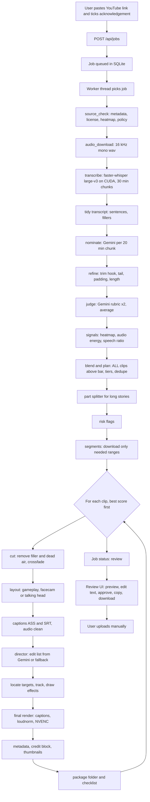
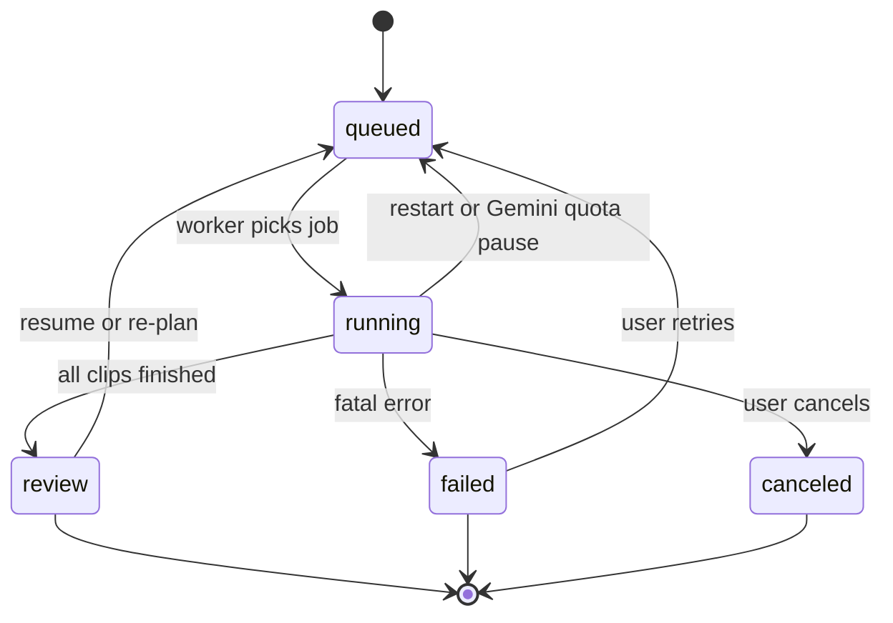
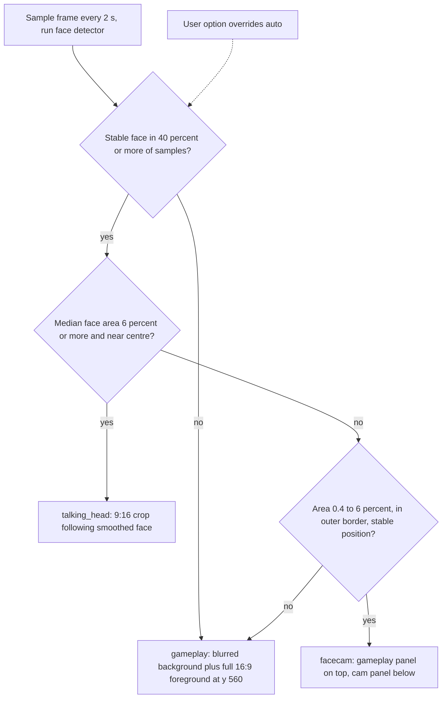
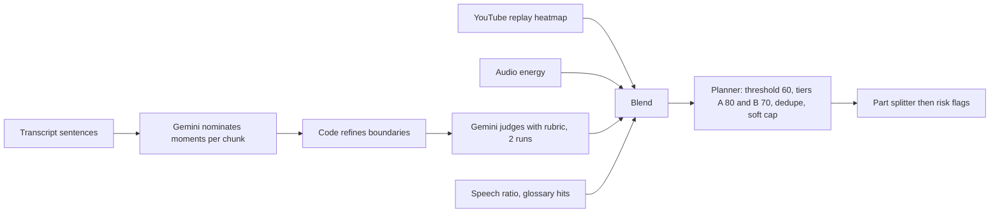
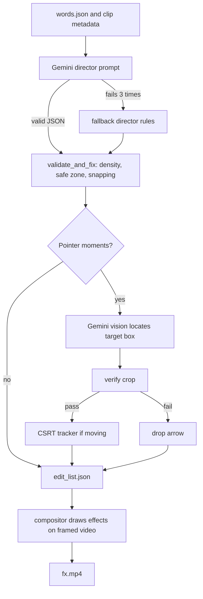
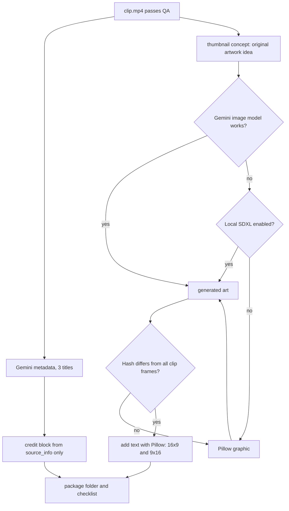
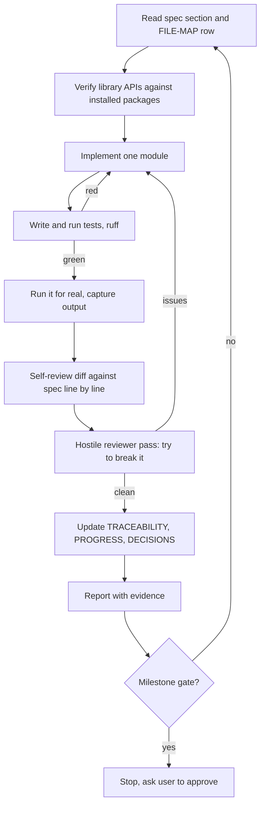

# FLOWCHARTS

Mermaid diagrams (render in GitHub, VS Code with a Mermaid extension, and most Markdown viewers). Text fallbacks are given where useful. Spec: `.agents/skills/shorts-engine/references/`.

## 1. End-to-end system flow

## 2. Job state machine

## 3. Layout decision tree

## 4. Selection and scoring

## 5. Director and effects

## 6. Packaging and thumbnails

## 7. Agent work loop (how Gemini must build every unit)

## 8. Milestone order

`M0 scaffold and env` -> `M1 ingest, selection, basic UI` -> `M2 build clips` -> `M3 director and effects` -> `M4 packaging, thumbnails, results` -> `M5 editor, polish, performance` -> final audit.
